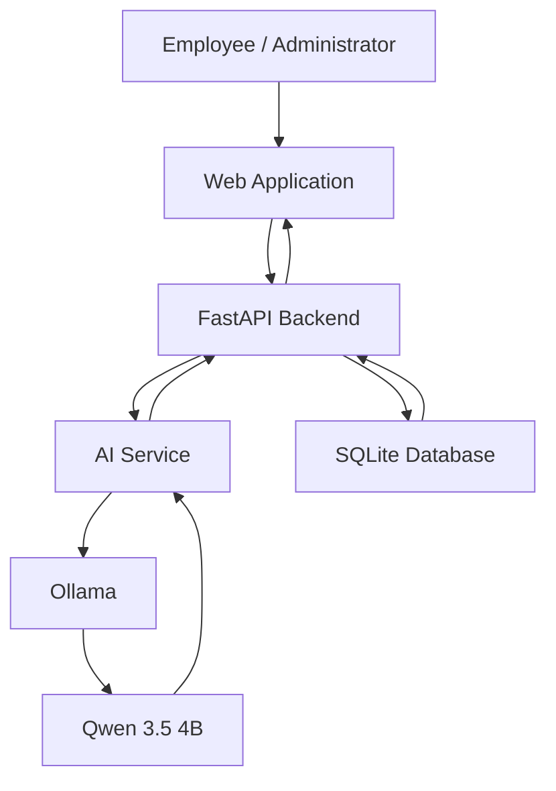

# NEXUS AI
### Generative AI Powered Unified Service Management Platform

NEXUS AI is a web-based IT Service Management (ITSM) prototype powered by Generative AI. It helps employees troubleshoot technical issues, submit IT support requests, and track service tickets through a unified platform.

The system integrates a locally hosted Large Language Model (LLM) through Ollama to analyze IT issues, suggest troubleshooting steps, classify tickets, and recommend priority levels.

## Features

- **Dashboard:** View total tickets, open tickets, in-progress tickets, resolved tickets, and recent service requests.
- **AI Assistant:** Get AI-powered troubleshooting guidance for common IT problems.
- **Submit Request:** Create IT support tickets by entering an employee name, issue title, and description.
- **AI Ticket Classification:** Automatically classify issues into categories such as Network, Hardware, Software, Account Access, Security, Email, and Other.
- **Priority Recommendation:** AI recommends Low, Medium, High, or Critical priority.
- **Ticket Management:** View submitted tickets and update their status.
- **SQLite Database:** Store ticket details, AI analysis, status, and timestamps locally.
- **REST API:** FastAPI backend with interactive Swagger documentation.

## Technology Stack

| Component | Technology |
|---|---|
| Frontend | HTML, CSS, JavaScript |
| Backend | Python, FastAPI |
| Generative AI | Ollama |
| AI Model | Qwen 3.5 4B |
| Database | SQLite |
| API Server | Uvicorn |

## System Architecture



## Ticket Processing Workflow

1. An employee enters an IT-related problem.
2. The frontend sends the issue to the FastAPI backend.
3. The backend communicates with the local Ollama AI service.
4. Qwen analyzes the issue and recommends a category and priority.
5. The backend stores the ticket and AI analysis in SQLite.
6. The ticket becomes available in the Service Tickets section.
7. An administrator or support user can update its status.
8. Dashboard statistics reflect the ticket updates.

## Project Structure

```text
NEXUS-AI/
│
├── backend/
│   ├── __init__.py
│   ├── database.py
│   ├── main.py
│   ├── models.py
│   │
│   └── services/
│       ├── __init__.py
│       └── ai_service.py
│
├── database/
│   └── nexus.db (created automatically)
│
├── frontend/
│   ├── index.html
│   │
│   ├── css/
│   │   └── style.css
│   │
│   └── js/
│       └── app.js
│
├── .env
├── .gitignore
└── README.md
```

## Installation and Setup

### Prerequisites

- Python 3.10 or newer
- Ollama installed on your computer
- Git
- A compatible local AI model

### Step 1: Clone the Repository

```powershell
git clone https://github.com/ASHS07X/NEXUS-AI.git
cd NEXUS-AI
```

### Step 2: Create a Virtual Environment

```powershell
python -m venv venv
```

Activate it using PowerShell:

```powershell
.\venv\Scripts\Activate.ps1
```

### Step 3: Install Dependencies

```powershell
python -m pip install --upgrade pip
pip install fastapi "uvicorn[standard]" ollama pydantic python-multipart python-dotenv
```

### Step 4: Install the AI Model

Make sure Ollama is installed and running.

Download the configured model:

```powershell
ollama pull qwen3.5:4b
```

Ollama documentation: https://docs.ollama.com/quickstart

### Step 5: Configure Environment Variables

Create a `.env` file in the project root directory:

```env
OLLAMA_MODEL=qwen3.5:4b
OLLAMA_HOST=http://localhost:11434
APP_NAME=NEXUS AI
```

**Important:** Keep `.env` local. Do not upload environment files, credentials, or private configuration to GitHub.

### Step 6: Run the Application

From the project root, execute:

```powershell
python -m uvicorn backend.main:app --reload
```

### Step 7: Open the Application

Once the backend starts, open:

- **Web Application:** http://127.0.0.1:8000
- **API Documentation:** http://127.0.0.1:8000/docs
- **Health Check:** http://127.0.0.1:8000/api/health

Keep the terminal and Ollama service running while using the application.

## API Endpoints

| Method | Endpoint | Description |
|---|---|---|
| GET | `/api/health` | Check application health |
| POST | `/api/chat` | Generate AI troubleshooting responses |
| POST | `/api/analyze` | Analyze and classify an IT issue |
| POST | `/api/tickets` | Create a new service ticket |
| GET | `/api/tickets` | Retrieve all service tickets |
| PATCH | `/api/tickets/{ticket_id}` | Update ticket status |
| GET | `/api/stats` | Retrieve dashboard statistics |

Interactive API testing is available through FastAPI Swagger UI at `/docs`.

## Demonstration Workflow

1. Open the NEXUS AI dashboard.
2. Navigate to the AI Assistant.
3. Enter an IT issue, such as a Wi-Fi connectivity problem.
4. Review the AI-generated troubleshooting response.
5. Navigate to Submit Request.
6. Enter employee details and describe the issue.
7. Submit the request and review the AI classification.
8. Open Service Tickets to view the created ticket.
9. Update the ticket status from Open to In Progress or Resolved.
10. Return to the dashboard and observe the updated statistics.

## Database

NEXUS AI uses SQLite for local ticket storage.

The database is created automatically when the backend starts.

**Database location:**

```text
database/nexus.db
```

Ticket records include:

- Ticket ID
- Employee name
- Issue title
- Issue description
- AI-generated category
- AI-recommended priority
- Ticket status
- AI analysis
- Resolution
- Created and updated timestamps

## Future Enhancements

Potential improvements for future versions:

- Employee and administrator authentication
- Role-based access control
- Ticket search and filtering
- Email and notification integration
- Advanced analytics and reporting
- SLA monitoring and escalation
- AI-powered resolution recommendations
- Audit logs and activity tracking
- Automated testing and deployment

## Project Information

**Project Name:** NEXUS AI  
**Project Type:** Generative AI-Based IT Service Management Platform  
**Developer:** Akash V  
**GitHub:** https://github.com/ASHS07X

---

*Built to explore the integration of Generative AI, local language models, and intelligent IT service management.*
